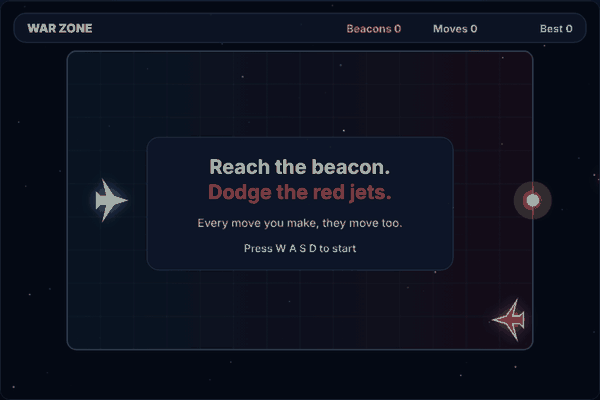

# War Zone

<p align="center">
  <a href="https://amatya27.github.io/WarZone/"></a>
</p>
<p align="center"><a href="https://amatya27.github.io/WarZone/"><b>Play it in your browser</b></a> &nbsp;·&nbsp; C++ original in <code>trial.cpp</code></p>

A small C++ graphics game from my first year of engineering (2020). You fly the blue plane, red enemy planes come at you across the screen, and you dodge them with the keyboard. It's built on **simplecpp**, IIT Bombay's turtle-graphics library for teaching C++.

## How to play

```
w  up        s  down
a  back      d  forward
x  exit (shows a smiley "Hope you Enjoyed the Game!" screen)
```

The game prints the rules, asks if you're ready, shows a loading bar and then reads one command at a time. Every move you make also moves the incoming planes.

## How it's built

- `planeShape` is a `Polygon` subclass. The plane outline is 12 points, scaled 2x and filled.
- One player plane (blue) and three enemies (red), each placed with turtle moves (`forward`, `left`, `right`).
- The battle area is a `Rectangle` and the target is a filled `Circle`.
- The exit screen draws the smiley with BGI graphics (`circle`, `floodfill`, `fillellipse`).

## Browser version

`docs/index.html` is a remake for the browser, hosted on GitHub Pages. It keeps what made the original: the same plane outline (the 12 points from `planeShape`), the same 900 x 600 canvas and battle rectangle, the beacon at (800, 300), the same W/A/S/D step sizes, X to land with the smiley goodbye, and the turn-based feel where every move you make moves the enemies too.

The original never checked whether you actually got hit, so this version adds the game around it:

- red jets that fly at you and respawn once they pass
- collision detection, so getting hit ends the run
- beacons to reach for points, with the jets speeding up after each one
- a best score saved in the browser
- a starfield, glowing planes, a grid over the battle area and a score bar
- on-screen buttons, so it works on phones

## Running the C++ version

You need simplecpp (it ships with its own `s++` compiler wrapper):

```bash
s++ trial.cpp -o warzone
./warzone
```

The exit screen uses Turbo C's BGI `graphics.h`, so that part only builds with a BGI-compatible setup such as WinBGIm.

**Updated in 2026:** removed the prebuilt `trial.exe` from the repo. Compiled binaries don't belong in source control, and it only ran on Windows anyway.
